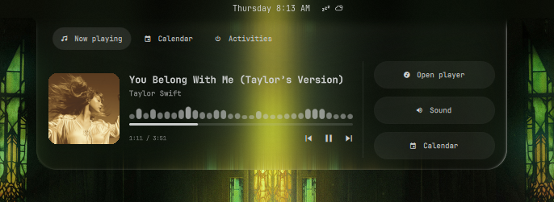
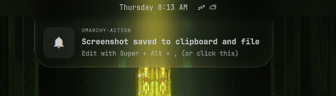
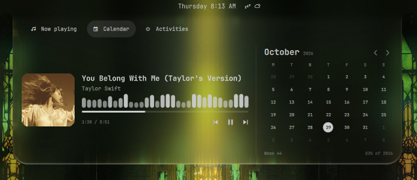
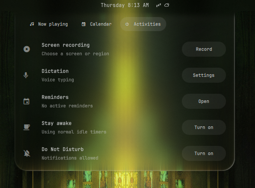

# Omarchy Notch

[](https://github.com/markerspoint/omarchy-notch/actions/workflows/ci.yml)

A Mac-style notch for the Omarchy desktop. It attaches beneath the centered
clock, expands on hover, and uses real frosted glass that follows your wallpaper.

## Features

- **Now playing:** artwork, track information, progress, and playback controls through MPRIS.
- **Live audio spectrum:** 32 Cava bands driven by your output audio, with smooth transitions.
- **Activities:** screen recording with elapsed time and stop/save, dictation, reminders, stay-awake, and Do Not Disturb.
- **Persistent status:** active recording and other ongoing activity remain visible when collapsed.
- **Notifications:** compact cards that resize around their text and support the notification's default action.
- **Calendar:** month navigation, today, week number, and year progress.
- **Live video preview:** mirrors a dedicated browser picture-in-picture window into the music pane.
- **Liquid glass:** wallpaper refraction, curved edge highlights, and a pointer-responsive sheen over compositor blur.
- **Desktop integration:** the clock still opens the notch; nearby bar buttons remain clickable.

## Screenshots









## Requirements

This is an **Omarchy shell plugin**, not a standalone Quickshell configuration.
It uses Omarchy's `qs.Commons` module, shell APIs, and desktop commands.

- A recent Omarchy installation using the Quickshell shell and Lua Hyprland configuration.
- A horizontal top bar with the clock centered.
- Python 3, Bash, `jq`, and ImageMagick (`magick`).
- An MPRIS-compatible player for media controls.
- Optional: Cava for the live audio spectrum, using PipeWire's PulseAudio compatibility server. Without Cava, the spectrum stays flat; playback controls, artwork, notifications, calendar, and activities still work. Install it with `omarchy pkg add cava`, then reopen the music pane.
- Optional: Voxtype for dictation, a browser PiP window and Hyprland toplevel capture for live video.

Developed against the installed Omarchy APIs in October 2026. Other shell versions
may need adjustments. Dimensions and timing are near the top of `Notch.qml`.

## Repository layout

This repository contains one plugin. `manifest.json`, its QML entry point, and
runtime helpers live at the repository root, as required by the Omarchy plugin
marketplace. `install.py` is the installer; `hypr/` contains the
optional glass rules and `tests/` contains development checks.

## Install

Install and enable the plugin with Omarchy's standard command:

```sh
omarchy plugin add https://github.com/markerspoint/omarchy-notch.git --enable
```

The repository is a ready-to-load root plugin. No build or custom installer is
required: the QML, runtime helpers, and compiled glass shader are included.
Omarchy manages installation and enablement. Cava and custom glass rules are
optional enhancements, not prerequisites for enabling the plugin. Update it with:

```sh
omarchy plugin update mark.notch
```

The command installs the current upstream code, which may differ from the
marketplace's verified snapshot.

### Optional glass setup and manual installation

The notch works without custom Hyprland rules. For the optional compositor blur
used in the screenshots, run the alternative installer:

```sh
curl -fsSL https://raw.githubusercontent.com/markerspoint/omarchy-notch/main/install.sh | bash -s -- --glass
```

This alternative requires `curl`, Git, and Python 3. It downloads the latest
`main` branch, copies the plugin, reloads Hyprland, and restarts the Omarchy
shell. It is also available without the optional glass rules: omit `--glass`.
Use the standard command above if you want Omarchy to manage plugin updates.

The installer copies the plugin to `~/.config/omarchy/plugins/mark.notch`,
adds it to the existing `shell.json`, and preserves other plugins and settings.
Backups go under `~/.config/omarchy/backups/notch-<timestamp>/`.

`--glass` also installs `~/.config/hypr/notch.lua` and loads it from
`~/.config/hypr/looknfeel.lua`. It enables blur and puts the bar and notch on the
same wallpaper blur path to avoid a visible seam. If you manage Hyprland rules
yourself, omit `--glass` and use [hypr/notch.lua](hypr/notch.lua) as a reference.
The installer does not install packages automatically.

For the transparent look, enable `bar.transparent` in Omarchy's `shell.json`.
Without transparency, the notch follows the bar's configured surface color.

## Use

In fullscreen, the notch attaches directly to the screen’s top edge; outside
fullscreen it joins the bar below the clock.

Hover over the center of the top bar, including the clock and nearby indicators, or just below it to peek. The notch stays open while the pointer remains there, and the bar buttons remain clickable. Click the clock or notch to pin it, and click
outside or on the clock again to close. Right-clicking the clock still cycles
its format; middle-clicking opens the timezone menu.

Open **Activities** for desktop controls. Recording or dictation starting will
peek at that view, and ongoing activities stay visible in the collapsed notch.
Starting or resuming playback, changing tracks, or switching the active player
automatically selects **Now playing**, even if Activities or Calendar was last
open. Manually choosing another tab stays in effect until the next playback
event. Audio analysis and video capture stop when their view is hidden.

For live YouTube video, first enable the browser's **Picture in picture** mode.
The notch mirrors that dedicated window, retaining the browser's audio and
playback controls. It does not extract video from background tabs. When no
matching PiP window exists—or more than one matches—it uses artwork instead.
The browser's PiP window remains available separately.

```sh
omarchy-shell mark.notch music
omarchy-shell mark.notch calendar
omarchy-shell mark.notch activities
omarchy-shell mark.notch show
omarchy-shell mark.notch hide
omarchy-shell mark.notch toggle
omarchy-shell mark.notch debug
```

## Notes

- Audio visualization monitors the default **output**, not the microphone. It can reflect other system audio too.
- Notification takeover dismisses the native toast after displaying it in the notch. Change `takeOverNativeToasts` to retain native toasts.
- Notification cards support up to two title lines and six body lines, with a maximum width of 520 pixels.
- PiP recognition currently expects an English “Picture-in-Picture” window title.
- Recorder detection follows Omarchy's `gpu-screen-recorder` process.
- Center-bar hover reads pointer coordinates through Hyprland's local IPC socket; it does not intercept clicks on neighboring bar widgets.
- The screenshots above show the notch running on a live desktop. The project contains no private wallpaper files or personal system configuration.

## Remove

For a standard installation:

```sh
omarchy plugin remove mark.notch
```

For a manual installation, remove `mark.notch` from the `plugins` array in
`~/.config/omarchy/shell.json`, then remove
`~/.config/omarchy/plugins/mark.notch/` and restart the shell.
If installed with `--glass`, remove the marked `require("hypr.notch")` block
from `looknfeel.lua` and remove `~/.config/hypr/notch.lua`. Reload Hyprland and
check `hyprctl configerrors`. Backups can be used to restore previous settings.

## Liquid glass

The expanded notch layers a GPU lens shader over Hyprland's wallpaper blur.
Refraction is concentrated around the curved perimeter; highlights follow the
pointer, while media, text, and controls stay sharp. The top edge fades into
the bar to preserve its seamless join. It samples the current wallpaper, not
private application windows, and falls back to the existing frosted surface
when no wallpaper texture is available. This is a custom effect, not Apple's
Liquid Glass rendering system.

Set `liquidGlassEnabled` to `false` near the top of `Notch.qml` to keep the
original frosted look. The effect uses the transparent bar mode. The precompiled
shader is included, so installation does not require development tools.
Developers can rebuild it with Qt Shader Tools:

```sh
/usr/lib/qt6/bin/qsb --qt6 --qsbversion 64 -o liquid-glass.frag.qsb liquid-glass.frag
```

The compatibility output targets Qt 6.4 and newer; compiling requires a recent
`qsb` supporting `--qsbversion`. CI also compiles the source on Ubuntu's Qt 6.4.

## CI and releases

GitHub Actions runs on pushes to `main`, pull requests, and manual CI runs:

- Installer, recorder-state, and archive tests on Python 3.11 and 3.14.
- QML parsing, shader compilation, ShellCheck, Bash syntax, and Lua syntax checks.
- A reproducible installable archive and `SHA256SUMS`, available as the
  `omarchy-notch` workflow artifact after all checks pass.

These checks do not replace testing on a running Omarchy desktop.

To publish a release, update `manifest.json` to the intended version, commit
and push the change, then push a matching tag. For example, when the manifest
version is `0.1.0`:

```sh
git tag v0.1.0
git push origin v0.1.0
```

The release workflow reruns CI, requires the tag to match the manifest version,
verifies the tested artifact's checksum, and publishes a GitHub release with
the archive and checksum. Publishing requires no additional repository secrets.

Build the same archive locally with `python scripts/package.py`.

## Development

```sh
python -m unittest discover -s tests -v
bash -n watch-navbar.sh
bash -n watch-notifications.sh
```

The recording-state tests use a temporary `/proc` fixture and never start or stop
recording. Installer tests use temporary configuration directories.

Built for [Omarchy](https://omarchy.org/), using [Quickshell](https://quickshell.org/)
and [Cava](https://github.com/karlstav/cava).

## License

[MIT](LICENSE) — Copyright (c) 2026 markerspoint.
